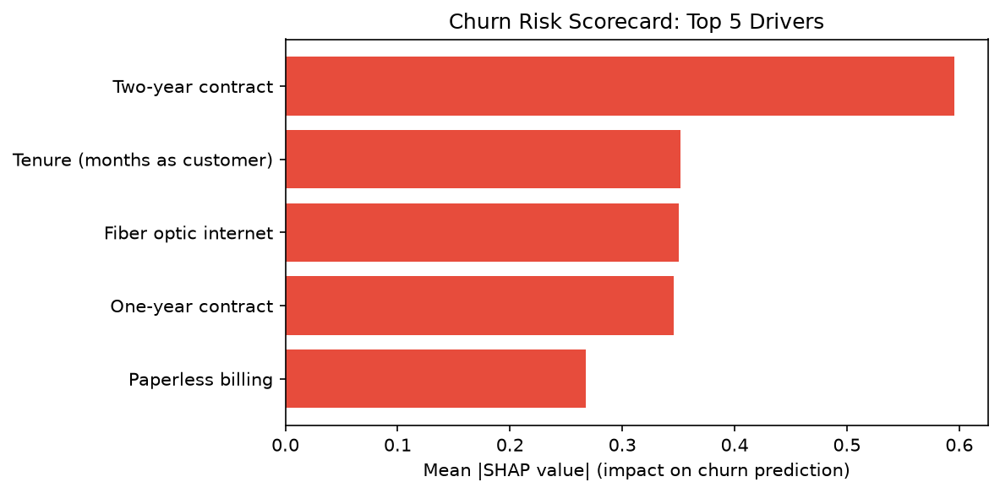

# Predict Customer Churn

Predicting telecom customer churn using machine learning to help retention teams intervene before customers leave.

## Problem
Telecom companies lose significant revenue to churn. This project identifies at-risk customers from behavioral and account data so retention teams can act proactively.

## Data
IBM Telco Customer Churn dataset: 7,043 customers, 21 features including contract type, tenure, monthly charges, and service subscriptions. ~26% churn rate (class imbalance handled with SMOTENC).

## Approach
1. **EDA**: Identified key churn drivers — contract type, tenure, and monthly charges.
2. **Feature Engineering**: Created `AvgMonthlyCharge` and `HasPremiumSupport` features; one-hot encoded categoricals.
3. **Modeling**: Trained Logistic Regression, Random Forest, and Gradient Boosting with 5-fold stratified CV.

## Results

| Model | ROC-AUC | Precision | Recall | F1 |
|---|---|---|---|---|
| Logistic Regression | 0.8257 | 0.5153 | 0.7219 | 0.6013 |
| Random Forest | 0.8211 | 0.5612 | 0.5882 | 0.5744 |
| Gradient Boosting | 0.8341 | 0.5386 | 0.7086 | 0.6120 |

**Best model**: Gradient Boosting — highest ROC-AUC and best precision/recall balance for the retention use case.

## Interpretability

Using SHAP values on the Gradient Boosting model, the top 5 drivers of churn
(ranked by mean absolute SHAP value) are:

1. **Two-year contract** (reduces churn) — customers on two-year contracts are
   by far the least likely to leave. This is the strongest single driver.
2. **Tenure** (reduces churn as it increases) — newer customers are
   significantly more likely to leave; risk falls steadily with time as a
   customer.
3. **Fiber optic internet** (increases churn) — fiber customers show elevated
   churn compared with DSL customers.
4. **One-year contract** (reduces churn) — less protective than a two-year
   contract, but still well below the month-to-month baseline.
5. **Paperless billing** (increases churn) — a smaller but consistent push
   toward churn.

Contract type is the dominant theme: the two contract features together outweigh
every other driver, and month-to-month customers (the baseline category for
both) are the highest-risk group. Other features that show up just outside the
top 5 include dependents, electronic check payment, and online security. These
are associations learned by the model, not causal effects, and correlated
features (contract, tenure, total charges) share credit.



*Bar length shows the average size of each feature's influence on the model's
predictions, not its direction. See the direction noted in each item above.*

## Project Structure
```
data/         # Raw and processed datasets
notebooks/    # 01_eda, 02_feature_engineering, 03_modeling, 04_shap_explainability
src/          # preprocessing.py, evaluation.py
models/       # Saved best model
reports/      # Figures and outputs
```

## Reproduce
```bash
pip install -r requirements.txt
jupyter notebook
```